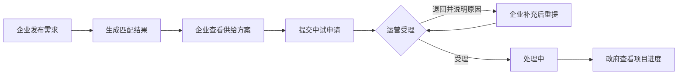

# 吉安市人工智能创新应用综合服务平台 Demo 开发文档

> 版本：V0.1（需求与 UI 设计基线，2026-10-28）  
> 演示对象：工信部门  
> 建设与演示主体：吉安新庐陵智城数据运营管理有限公司  
> 目标演示时间：2026 年 12 月初  
> 本文档规定 Demo 的页面、交互、数据及验收边界；不代表 2028 年完整平台已经建成。

## 1. 文档依据与决策

### 1.1 依据顺序

1. [建设方案汇报 PPT](吉安市人工智能创新应用综合服务平台建设方案.pptx)：Demo 的功能、文案和汇报顺序以此为基线。
2. [吉安市 AI 先行示范区项目行动计划](../original/吉安市AI先行示范区项目行动计划.png)：确认汇报主体、时间与建设背景。
3. [项目材料文字提取稿](../original/AI先行示范项目材料_文字提取.md)：补充功能细节与典型案例；与 PPT 冲突时不直接覆盖 PPT。
4. [VPwork 截图目录](../original/vpwork截图/)：只参考界面结构、信息密度与交互节奏，不复用其标识、产品名称和原有业务菜单。

公开代码仓库只包含代码和本开发文档。上述 PPT、行动计划、项目材料和 VPwork 截图保留在本地 `docs/original/` 等目录，不随仓库上传；异地开发或 UI 评审时需通过授权渠道单独提供，仓库中的相对链接仅在本地完整工作区可打开。

### 1.2 已确定的产品决策

| 事项 | Demo 决策 |
| --- | --- |
| 演示主线 | 企业发布场景需求 → 查看推荐方案 → 申请中试 → 运营受理 → 政府查看同一项目 |
| 覆盖范围 | 八大核心应用均有可进入页面；产业联盟作为配套模块 |
| 终端 | PC 浏览器优先，同时检查平板宽度；本期不开发 uni-app 页面 |
| 入口 | 公开门户 + 登录后的企业、运营、政府工作台 |
| 数据 | 默认由 AI 服务内存 Mock 提供；案例和统计显著标注“演示数据” |
| 智能匹配 | 可解释规则匹配；界面不宣称已经接入大模型或知识图谱 |
| AI 服务中心 | 目录、详情、申请和一个场景方案推荐示例；不接真实模型推理 |
| 本期完成深度 | 主线做到申请提交、运营受理、政府可查询；不做专家评审和正式验收 |

### 1.3 对外表述边界

- PPT 中的“1280P 算力、386 家机构、380 个需求、95% 匹配度”和政府看板的“186 家企业、128.5 亿元产值、92 个项目、64 项备案算法”属于**方案演示数据**。数值出现的页面均显示“演示数据”，且不得作为真实运营报表导出。
- “到 2028 年”的 15 个开放场景、4 个行业、5 个行业模型、15 个场景模型、10 个智能体、100 家以上服务企业等指标标为**建设目标**，不混入当前运营数据。
- 原材料的总投资有约 1200 万、2000 万等不同口径，行动计划另有项目预算表述。Demo 不展示未确定的总投资数字。
- PPT 第 5 页将“产业联盟 / 赛事”放在同一展示组；页面菜单按“八大核心应用 + 产业联盟配套模块”分别提供入口。
- PPT 中的第三方供应商、案例和评分只作为演示案例，详情需标识“方案示例”，不暗示已签约或获得授权合作。

## 2. 两步实施与验收门槛

### 第一步：先完成 UI

目标是形成可评审的完整视觉和页面结构，**在 UI 评审通过前不启动业务接口与数据库开发**。

交付内容：

1. 从 VPwork 截图提炼设计规范：导航、工作区、目录卡片、列表、详情分栏、表单、状态标识和空态。
2. 设计新庐陵品牌的公开门户，以及企业、运营、政府三个工作台的统一界面体系。
3. 完成第 4 节全部页面的高保真、可点击 UI 原型；用独立的设计预览数据表现页面状态，预览内容不进入正式运行接口，也不充当业务 Mock API。
4. 提供 1440×900、1920×1080、768×1024 三种视口的关键页面截图，并完成长标题、表格、弹窗和空态检查。
5. 逐页审查菜单、视觉风格、信息层级和演示路径；修改到确认后，冻结 UI 基线。

第一步通过条件：所有页面可按演示路径点击到达；导航与页面层级一致；首页、资源目录、业务列表、详情、申请表和政府看板均有定稿画面；没有明显遮挡、溢出或空白占位。此阶段的提交按钮只展示交互状态，不声称业务已办理。

### 第二步：再开发业务

在定稿 UI 上接入真实 Express API、内存 Mock 数据源、权限与业务状态。阶段一的设计预览数据从正式运行代码中移除，业务页面只通过真实后端取数。完成主线闭环、其他模块的浏览与申请、演示数据初始化、自动化与浏览器验收；需要持久化时可显式切换独立 MySQL 模式。

第二步通过条件：新建需求、匹配、中试申请、运营受理、政府查询跨账号一致；服务运行期间刷新可查询，重启后恢复标准种子数据；角色越权被后端拒绝；演示数据与建设目标口径清楚。

## 3. VPwork 风格转译与界面规范

### 3.1 截图观察与目标用途

| 参考截图 | 可借鉴的界面特征 | 用于本 Demo |
| --- | --- | --- |
| [应用广场](../original/vpwork截图/054e3539-8260-494c-bfbb-2d289bfdfcdc.png) | 窄图标栏、二级导航、顶部分类、统一目录卡片 | AI 服务中心、供给资源、赛事目录 |
| [平台仓库](../original/vpwork截图/61c81d74-fe7b-4b00-a89b-b5cf4685b2c1.png) | 平铺资源目录、紧凑元数据、操作位固定 | 模型、数据集、算力资源目录 |
| [业务协同](../original/vpwork截图/effa36c0-d792-4225-a720-7f6d1597fcdf.png) | 左侧任务区、顶部统计、密集但可扫描的表格 | 企业工作台、运营受理台 |
| [列表与详情分栏](../original/vpwork截图/db047ded-bca2-4dcd-8625-dd53c8c12395.png) | 左列表右详情、筛选页签、未选中空态 | 申请办理、项目台账、揭榜任务 |
| [自动化工作台](../original/vpwork截图/7e0f0a0f-a9a9-47e7-b818-713ef203e6e0.png) | 任务列表与运行记录并列、状态直接可见 | 中试任务与受理记录 |

### 3.2 设计落地规则

- **公开门户**：首屏必须出现平台全称和新庐陵主体，结合吉安城市真实图片建立地域识别；导航、搜索和办事入口保持工作型产品的克制感。
- **登录后工作台**：桌面端采用约 64px 图标导航栏、约 250px 模块侧栏、约 48px 顶栏和可滚动内容区。顶栏显示当前位置、全局搜索、演示身份与个人菜单。
- **视觉体系**：以白色和浅灰工作区、细边框、少量阴影建立层次；橙色用于主要命令，绿色用于已连接/完成，蓝色用于链接和信息，红色用于风险。颜色集中定义为主题变量，不在页面散写色值。
- **内容密度**：目录用等宽网格；业务台账以表格和列表为主；详情优先右侧分栏或抽屉，避免每次跳转打断演示。单项卡片圆角不超过 8px，不把完整页面包成浮动卡片。
- **操作习惯**：分类用页签或分段控制；筛选用搜索框和下拉框；状态用标签；数值用输入或步进；图标按钮加提示。删除、退回等动作有确认和结果反馈。
- **品牌边界**：不复制 VPwork Logo、名称、图标排列和桌面窗口装饰。平台使用“吉安 AI”文字标识与新庐陵公司全称。
- **响应式**：1440px 和 1920px 保持完整多栏；768px 将二级栏收起为抽屉，卡片减少列数，表格允许横向滚动，不压缩文字到不可读。

### 3.3 页面骨架

```text
公开门户
┌ 平台标识 ─ 首页 / 供需 / AI服务 / 产业生态 / 政策资讯 ─ 登录 ┐
├ 吉安图片与平台名称 / 关键入口 ────────────────────────────┤
├ 我要办 / 我要查 ─────── 平台能力与资源 ───────────────────┤
└ 典型场景 / 政策资讯 / 新庐陵主体 ────────────────────────┘

登录后工作台
┌ 顶栏：当前位置 / 搜索 / 演示身份 / 个人菜单 ───────────────┐
├ 图标栏 ┬ 二级侧栏 ┬ 页签、筛选、主内容 ──────────────────┤
│ 64px  │ 约250px   │ 列表、目录、图表或办理详情             │
└───────┴───────────┴──────────────────────────────────────┘

办理型页面
┌ 页标题与主要命令 ────────────────────────────────────────┐
├ 状态页签 / 搜索 / 筛选 ───────────────────────────────────┤
├ 记录列表或表格 ─────────── 选中记录详情 / 时间线 ────────┤
└ 分页 / 空态 / 错误重试 ───────────────────────────────────┘
```

## 4. 信息架构与页面规格

### 4.1 导航与角色

应用工作台顶级导航最多五组：**首页、产业服务、AI 服务、产业生态、角色工作台**。产业服务含供需大厅、中试验证、资质评测；AI 服务含算力、模型、数据、智能体；产业生态含赛事、揭榜、联盟。角色工作台根据账号显示企业、运营或政府内容。现有系统管理通过管理平台入口提供给管理员，不挤入业务导航。

| 角色 | 可见范围 | 主要写操作 |
| --- | --- | --- |
| 公众 | 门户及公开资源、资讯 | 无；申请时引导登录 |
| 企业演示账号 | 公开内容、企业工作台及业务模块 | 发布需求、提交各类申请、查看自身进度 |
| 运营演示账号 | 公开内容、业务模块、运营工作台 | 受理/退回申请、更新进度与说明 |
| 政府演示账号 | 公开内容、政府工作台及项目台账 | 本期只读，不修改企业申请 |
| 系统管理员 | 系统管理 | 维护用户、角色、菜单和平台配置 |

### 4.2 页面总表

页面 ID 对应下方详细规格。详情若标注为“抽屉/分栏”，仍需有可直接访问的详情路由，便于刷新和分享；窄屏可改为整页。

当前实现统一挂在 `/ai-demo` 下；企业、运营、政府页面分别使用 `/enterprise/*`、`/operations/*`、`/government/*` 子路径。目录独立详情为 `/ai-demo/detail/:kind/:id`，申请和项目台账可在各自列表路径后追加记录 ID 直达。

| ID | 页面 | 入口与主要区域 | 角色 | 主要动作 |
| --- | --- | --- | --- | --- |
| P01 | 公开首页 | `/`：品牌、指标、我要办/查、案例、资讯 | 全部 | 搜索、跳转、登录 |
| P02 | 综合检索 | `/search`：资源分类、结果列表、详情 | 全部 | 查询、筛选、查看 |
| P03 | 登录与身份选择 | `/login`：三个演示身份 | 未登录 | 登录、切换身份 |
| P04 | 企业工作台 | `/workbench`：待办、最近需求/申请 | 企业 | 继续办理、查看进度 |
| P05 | 供需大厅 | `/services/demands`：需求/供给页签 | 全部 | 筛选、详情、发布需求 |
| P06 | 需求办理 | `/services/demands/new`、`/:id`：表单/详情 | 企业 | 保存并发布、查看匹配 |
| P07 | 匹配结果 | `/services/demands/:id/matches`：前三推荐与原因 | 企业、运营 | 查看方案、申请中试 |
| P08 | AI 服务中心 | `/ai/resources`：四类目录与示例体验 | 全部 | 筛选、查看、申请资源 |
| P09 | 中试验证中心 | `/services/pilot`：服务、环境、任务 | 全部 | 申请中试、查进度 |
| P10 | 赛事活动 | `/ecosystem/events`：赛事列表/详情 | 全部 | 报名申请 |
| P11 | 揭榜挂帅 | `/ecosystem/tasks`：榜单/详情 | 全部 | 揭榜申报 |
| P12 | 资质与评测 | `/services/qualification`：认定/评测/伦理 | 全部 | 办理申请 |
| P13 | 产业联盟 | `/ecosystem/alliance`：简介/成员/入会 | 全部 | 入会申请 |
| P14 | 我的办理 | `/my/applications`：全部申请与状态时间线 | 企业 | 查看、补充退回材料 |
| P15 | 运营受理台 | `/operations/applications`：待办队列与详情 | 运营 | 受理、退回、更新进度 |
| P16 | 政府总览 | `/government/overview`：指标、趋势、动态 | 政府 | 筛选、下钻 |
| P17 | 政府项目台账 | `/government/projects`：项目列表、详情与时间线 | 政府 | 查询、查看 |

### 4.3 逐页功能与界面状态

| 页面 | 必须呈现的区块和交互 | 必须设计的状态 |
| --- | --- | --- |
| P01 | 平台全称、吉安图片、四大能力、PPT 指标、“我要办/我要查”、政策动态和典型案例；点击入口能到对应模块。 | 首屏加载、资讯为空、未登录点击办理时的登录引导。 |
| P02 | 搜索框、资源类型页签（方案/模型/数据/服务商/政策/办理进度）、结果摘要、列表与详情；办理进度仅登录本人可查。 | 无结果、搜索失败、无权限查看进度。 |
| P03 | 三个演示身份卡与账号密码登录；切换身份先退出当前账号再重新认证。 | 密码错误、接口不可用、登录中。 |
| P04 | 我的需求数、待受理/办理中申请、最近办理、下一步操作；指标从本人记录计算。 | 无申请时给出发布需求入口。 |
| P05 | “需求广场/供给资源”分段控制，关键词、行业、场景、状态筛选；列表固定展示标题、行业、预算、地区、截止时间和状态；点击打开详情。 | 列表为空、筛选无结果、加载失败。 |
| P06 | 发布表单、校验错误定位、提交成功跳转详情；详情展示需求内容、当前状态、匹配入口及办理时间线。 | 必填缺失、提交中、提交失败、本人/他人查看权限差异。 |
| P07 | 需求摘要、规则匹配说明、前三供给方案的分数与命中原因、方案详情及“申请中试”；不展示伪造的即时 AI 推理动画。 | 无匹配、规则条件不足、匹配服务失败。 |
| P08 | 算力/模型/数据/智能体四页签，分类筛选、资源卡/表、详情和申请；示例体验输入行业、场景、预算、周期，返回规则推荐及理由。 | 各分类空态、申请成功/失败、示例输入不完整。 |
| P09 | 三类中试服务、可用测试环境、任务列表、申请表、本人申请进度；认证报告仅在已有演示附件时显示。 | 无任务、申请退回、环境不可预约。 |
| P10 | 赛事时间、报名条件、截止日期、赛事详情、报名表与“我的报名”。 | 已截止、已报名、报名资料缺失。 |
| P11 | 榜单类别、发布单位、任务周期、申报截止、奖励口径、任务详情和揭榜表。 | 已截止、资格提示、重复申报。 |
| P12 | 企业认定、检测评测、伦理审查三页签；每项有适用对象、材料清单、办理流程、申请入口。 | 材料不全、待受理、退回补件。 |
| P13 | 联盟介绍、成员单位、服务内容与入会申请。 | 已申请、无成员、申请退回。 |
| P14 | 按类型/状态筛选本人所有申请，列表左侧、详情右侧显示申请内容与处理时间线；退回可补充说明后重新提交。 | 无办理记录、处理中、完成、退回。 |
| P15 | 待受理/处理中/已办结页签，按类型和企业筛选，列表与详情分栏；受理、退回、进度更新都记录处理人和时间。 | 无待办、并发重复处理、无权限操作。 |
| P16 | PPT 所列四个指标、近 12 月趋势、场景分布、近期动态；图表点击进入对应台账。 | 图表无数据、统计更新时间、演示数据标识。 |
| P17 | 项目类型、行业、状态、时间筛选；项目详情含关联需求、中试申请及完整处理记录。 | 无项目、关联记录缺失、只读权限。 |

P05、P08、P10、P11 等目录页遵循同一信息层级，但不机械复制相同卡片。P14、P15、P17 使用 VPwork 参考截图中的“列表 + 详情”工作区模式。

## 5. 主线流程与字段



### 5.1 需求发布与匹配

| 字段 | 规则 |
| --- | --- |
| 需求名称 | 必填，5-100 字；列表和匹配结果沿用同一名称 |
| 需求类型 | 必填；AI 转型、技术攻关、资源申请、其他 |
| 所属行业 | 必填；首批电子信息制造、现代农业、文旅服务、政务治理 |
| 需求场景 | 必填；自由描述，至少 10 字；可选场景标签 |
| 需求描述 | 必填，20-2000 字；说明痛点、预期效果和交付要求 |
| 预算范围 | 可选，最小值不得大于最大值；单位“万元” |
| 期望交付周期 | 必填，按月选择 1-24；用于匹配评分 |
| 联系人/联系方式 | 必填；仅本人和运营可见，不在公开需求列表展示 |

提交后生成唯一 `demand_no`，状态为“已发布”。需求详情和匹配结果以需求 ID 关联，推荐结果按请求时的供给资源计算并保留评分依据。行业匹配 35 分、场景标签匹配 35 分、预算相容 20 分、交付周期相容 10 分；总分降序取前三，相同分数按供给 ID 稳定排序。缺失可选预算时该项记 0 分并说明，不能虚构精确匹配率。

### 5.2 中试与通用服务申请

中试表单必填：关联需求、选中供给方案、申请单位、服务类型（模型效果验证/安全评测/适配调试）、预期验证目标、联系人及联系方式；测试环境和附件可选。提交生成唯一 `application_no`。其他服务（资源、赛事、揭榜、资质/评测、联盟）使用“服务类型 + 目标资源 + 申请单位 + 联系人 + 说明 + 附件”的通用申请结构，各页面只增加其必要专属字段。

申请状态统一为“待受理 → 已受理 → 处理中 → 已完成”，也允许运营从待受理或处理中退回；退回必须填写原因，企业补充后回到待受理。所有状态变化记录操作者、时间、备注。企业只见自己的申请，运营可处理全部，政府只读全部。

### 5.3 演示账号与数据

内存 Mock 初始化三个角色账号及至少四条行业需求、三条供给方案、四类 AI 资源、三种中试环境和适量赛事/榜单/政策案例。种子数据与现场新提交的数据分开标识；重启 AI Demo 服务即可恢复标准演示状态。需要持久化时可切换到独立 `_demo` MySQL 模式，并使用受保护的重置命令。账号凭据写在本地启动说明中，不写入公开门户。

## 6. 技术接口与数据边界

本章为第二步开发的接口契约。前端请求路径不带 `/api` 前缀；服务端保持 `{ code, message, data }`，写请求携带 `Authorization: Bearer <token>`。公开查询只返回公开字段。

| API 组 | 最小接口 | 作用 |
| --- | --- | --- |
| 门户与目录 | `GET /ai/portal`、`GET /ai/search`、`GET /ai/catalog?category=...`、`GET /ai/catalog/:id`、`GET /ai/suppliers/:id` | 首页、综合检索、模型/数据/算力/智能体及生态目录 |
| 需求 | `GET /ai/demands`、`POST /ai/demands`、`GET /ai/demands/:id` | 列表、发布与详情 |
| 匹配 | `GET /ai/demands/:id/matches` | 返回供给 ID、0-100 分、命中原因和规则版本 |
| 申请 | `POST /ai/applications`、`GET /ai/applications`、`GET /ai/applications/:id` | 中试与各类服务申请、本人办理查询 |
| 运营 | `GET /ai/operations/applications`、`PATCH /ai/operations/applications/:id/status` | 受理、退回、进度更新 |
| 政府 | `GET /ai/government/overview`、`GET /ai/government/projects` | 产业指标与项目台账 |

AI Demo 的数据模型包括 `ai_demands`（需求及私密联系信息）、`ai_suppliers`（供给能力与适配标签）、`ai_catalog_items`（资源与生态目录）、`ai_applications`（通用/中试申请及当前状态）、`ai_application_events`（完整状态历史）、`ai_metrics`（示意指标）及账号、令牌、附件表。内存 Mock 与可选 MySQL 模式共用这组接口契约；业务表包含项目规范要求的 `id`、`created_by`、`created_at`、`updated_at`，业务编号按插入 ID 生成。AI Demo 不复用系统库的编码规则表。

当前仓库动态菜单创建接口存在未定义函数与异步调用未等待的问题。第二步接入新菜单前应先修复并测试，按角色初始化新菜单与 `role_menus`，避免仅超级管理员能进入页面。现有脚手架中仍有旧工厂业务文件和内存 Mock 实现；它们不作为 AI Demo 数据源，也不出现在演示导航中。

## 7. 开发顺序与验收清单

### 7.1 顺序

1. 核对本文件的页面清单及 VPwork 风格转译；完成第一步全部 UI 原型与视口截图。
2. 根据反馈修改页面结构、文案和视觉；记录确认版 UI 基线。
3. 建立内存 Mock 数据、账号、种子数据与 API；如需持久化再启用独立 MySQL 演示库；修复菜单权限链路。
4. 接入企业主线，再接运营与政府视角；最后接其他模块的目录和通用申请。
5. 执行接口、权限、浏览器及现场演示脚本验收；保留可重置的演示数据。

### 7.2 第一阶段 UI 验收

- P01-P17 均有可审查画面，点击路径连续；页面标题、菜单归类与 PPT 八大应用对应。
- 用上述五张 VPwork 参考截图逐项检查导航、目录、列表详情和状态样式，同时确认没有复制其品牌。
- 1440×900、1920×1080、768×1024 截图无文字溢出、按钮错位、遮挡和空白内容区；长名称、空列表、加载与报错状态都有设计。
- 企业、运营、政府三种身份的菜单差异在原型中可见；演示数据标签与建设目标标签清楚。

### 7.3 第二阶段功能验收

- 企业新建需求后，匹配结果随行业、场景、预算和周期变化；推荐理由与分数来源一致，无匹配时有明确提示。
- 企业提交中试申请，运营可受理或退回，政府能看到同一申请及处理时间线；服务重启后恢复标准演示数据。
- 其他模块的目录、详情和申请入口可用，申请汇入“我的办理”和运营受理台。
- 未登录不能提交；企业不能查看他人私密联系信息；政府不能修改申请；越权请求由服务端拒绝。
- 页面没有把示意指标标成真实成果；不出现未确认投资金额、无依据的合作关系或“已接入大模型”文案。
- 完成前端构建、后端接口测试与 PC/平板浏览器关键路径截图；演示重置后仍能按相同脚本重走全程。

## 8. 本期不实现

uni-app 移动端、独立指挥大屏、真实 GPU 调度和计费、真实模型 API 调用、数据集下载交易、拖拽式智能体编排、专家评审、正式检测认证报告、政策资金兑现和生产环境部署。这些内容可在页面说明中作为平台规划出现，但不可提供会误导用户的可点击“完成”操作。
